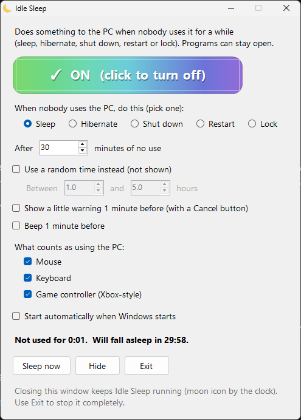
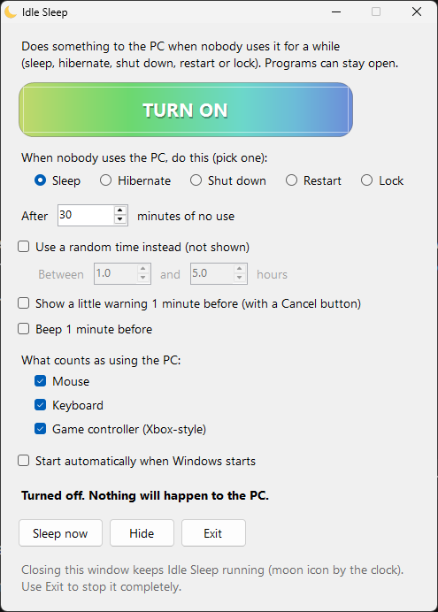
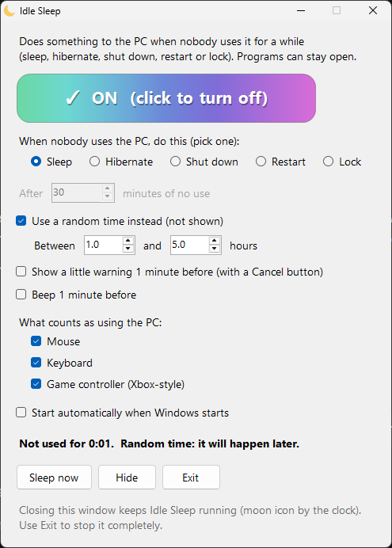
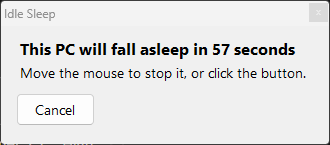

# Idle Sleep

**Puts your PC to sleep when you stop using it, even while a game is open.**

Windows' own sleep timer gets stuck when a game, video or download is running, so the PC stays on all night.
Idle Sleep doesn't care what is open. If nobody touches the mouse, keyboard or controller for the time you
choose, it puts the PC to sleep for you. That helps save electricity, heat and wear on your computer, and you
don't have to remember to do it.

## What it can do

- **Works while games and programs are open.** Leave a game running, walk away, and the PC still goes to sleep.
- **Pick one action:** Sleep, Hibernate, Shut down, Restart or Lock.
- **You choose the time.** For example 30 minutes of no use.
- **Random time (optional).** Pick a random wait between two numbers of hours (for example 1 to 5). It does not show how long is left.
- **You choose what counts as using the PC:** Mouse, Keyboard and/or Xbox-style game controller. For example, tick only the mouse and typing won't stop it.
- **Optional warning and beep** 1 minute before, with a Cancel button. Both are off at first.
- **Sits by the clock** as a small moon icon. Right-click it to turn off, do it now, or exit.
- **Can start with Windows** (starts turned on).
- Small, free, no install, no internet, no tracking.

| Window | Random time | Warning (optional) |
|---|---|---|
|  |  |  |

## How to use it

1. Download **IdleSleep.exe** (click it above, then the download button).
2. Double-click it. It always opens **turned off**.
3. Pick what to do and how many minutes.
4. Click the big **TURN ON** button.
5. Close the window. It keeps running as a moon icon by the clock (it may be under the `^` arrow).

Windows may show a blue "Windows protected your PC" box because the program is new and not signed.
Click **More info** then **Run anyway**. The full source code is in this repo if you want to check it or build it yourself.

## Good to know

- **Shut down / Restart:** a program with unsaved work can stop Windows from finishing. "Force programs to close" always
  makes it go through, but unsaved work is lost. It is off at first.
- **Controllers:** only Xbox-style controllers count as "using the PC". If you play with another kind, untick the
  controller option or turn Idle Sleep off while you play.
- **Some laptops:** Windows may hibernate instead of doing a normal sleep on some laptops. Hibernate still saves power.
- Settings are saved in `IdleSleep-settings.txt` next to the program. `IdleSleep-log.txt` lists what it did and when.

## Build it yourself

Windows already has the C# compiler. Double-click `build.bat` and it makes `IdleSleep.exe` from `IdleSleep.cs`.
No other tools are needed.

## Open source

This is free and open source under the [MIT License](LICENSE). You can use it, change it and share it.
Ideas and fixes are welcome: open an issue or a pull request.
